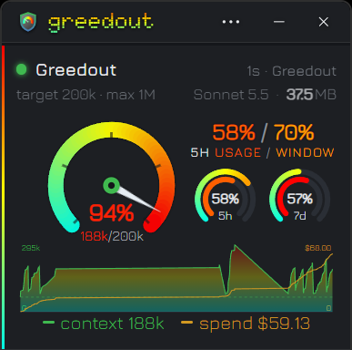
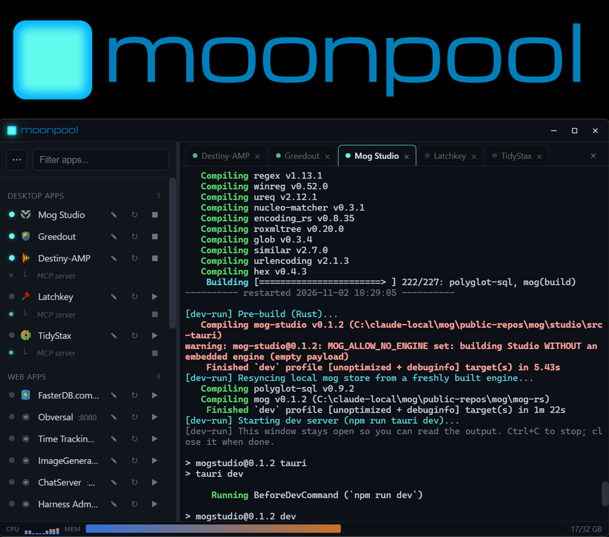
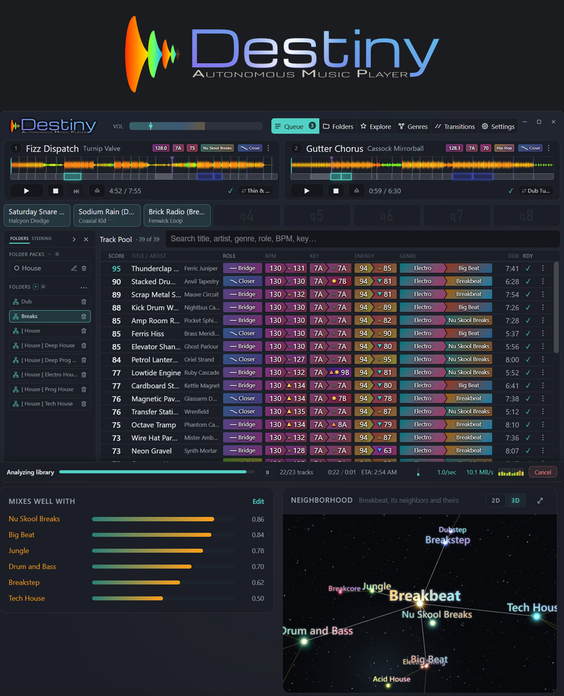
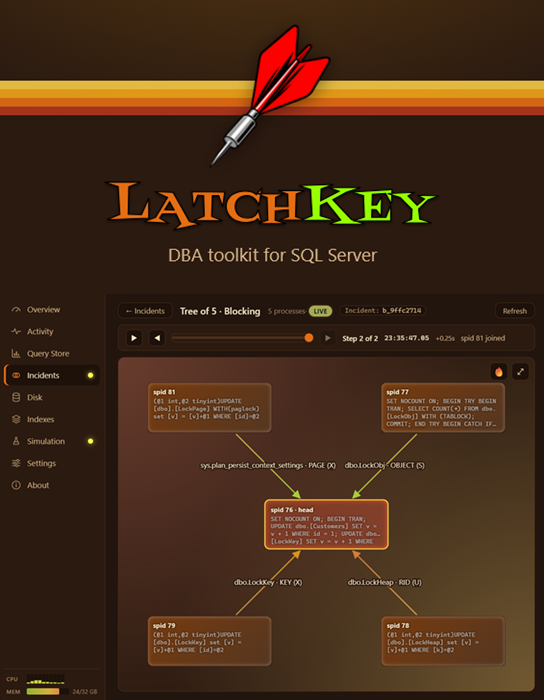
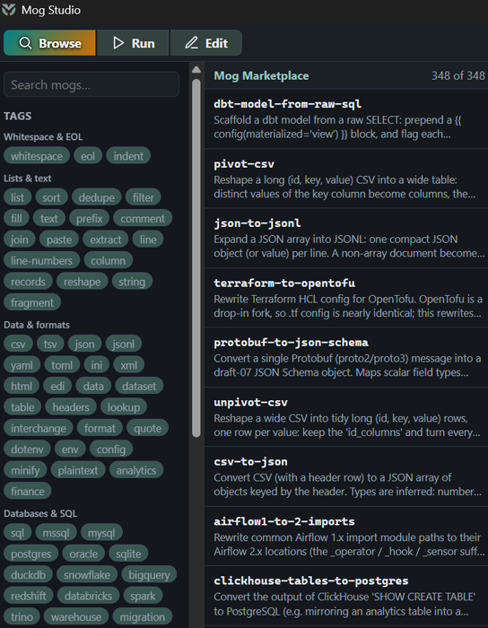

# Justin Keener

SQL Server and data engineer with 27 years of experience, currently building tools in Rust, Svelte and PostgreSQL. Open to data roles.

## Highlights

<table>
  <tr>
    <td align="center" width="33%">
       
      <a href="https://github.com/kjustinkeener/Greedout"><b>Greedout</b></a> 
      Live AI coding-session context and spend dashboard
    </td>
    <td align="center" width="33%">
       
      <a href="https://github.com/kjustinkeener/Moonpool"><b>MoonPool</b></a> 
      Tray launcher for local apps and dev servers (MIT)
    </td>
    <td align="center" width="33%">
       
      <a href="https://github.com/kjustinkeener/destiny-amp"><b>Destiny-AMP</b></a> 
      Music player with automatic mixing
    </td>
  </tr>
  <tr>
    <td align="center" width="33%">
       
      <a href="https://github.com/kjustinkeener/latchkey"><b>Latchkey</b></a> 
      SQL Server monitoring for DBAs
    </td>
    <td align="center" width="33%">
       
      <a href="https://github.com/kjustinkeener/mog"><b>Mog</b></a> 
      Scripted text transforms and a signed recipe registry
    </td>
  </tr>
</table>

## Open source
- [MoonPool](https://github.com/kjustinkeener/Moonpool): tray launcher for local apps and dev servers (MIT)
- [Greedout](https://github.com/kjustinkeener/Greedout): live AI coding-session context and spend dashboard
- [Mog](https://github.com/kjustinkeener/mog) and [mog-market](https://github.com/kjustinkeener/mog-market): scripted text transforms and a signed recipe registry

## Also built
- [Latchkey](https://github.com/kjustinkeener/latchkey): SQL Server monitoring for DBAs
- [Destiny-AMP](https://github.com/kjustinkeener/destiny-amp): music player with automatic mixing

Most of this was built with AI coding assistants (Claude Code); I own the design, testing and results.

Site: [fasterdb.com](https://fasterdb.com)
